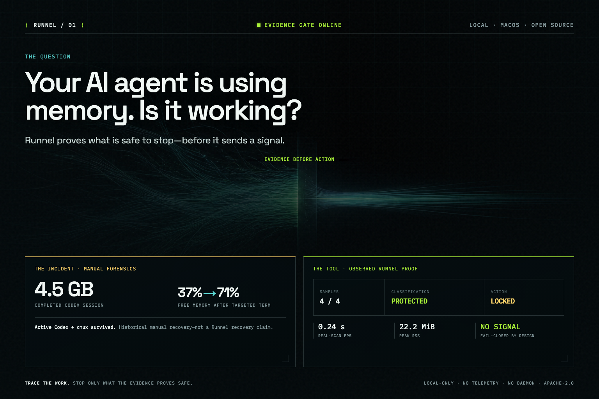

# Runnel

> Trace the work. Stop only what the evidence proves safe.



[Watch the 23-second public-safe demo](https://github.com/ArshyaAI/runnel/blob/main/assets/launch/runnel-demo-v011-social.mp4):
real v0.1.1 version/self-test, then an explicitly labeled synthetic contradictory
fixture that stays locked. No live process scan or recovery is recorded.

Runnel is a local-first macOS CLI for developers running many AI coding
workflows. It answers two different questions without pretending they are the same:

1. **What is using my workstation right now?** — a fast, read-only workflow radar.
2. **Is this exact worker safe to stop?** — a versioned, fail-closed evidence contract.

## Try it

```bash
brew install ArshyaAI/tap/runnel
runnel doctor --self-test
runnel scan
```

`scan` is read-only. macOS permission limits can produce documented partial exit `3`
while still returning the evidence that was available.

```text
$ runnel scan
Runnel 0.1.1 | darwin/arm64
Snapshot: 314 workflow group(s) | showing 24, omitted 290 low-signal group(s)

PROTECTED wf-… [codex] — 11 processes, 504.2 MiB RSS
RECENT    wf-… [browser] — 7 processes, 318.0 MiB RSS
QUIET     wf-… [codex] — 1 process, 142.7 MiB RSS

$ runnel explain wf-…
Samples: 4/4 | stack attempted: false
Classification: protected | selectable: false
Action: locked. Runnel will not signal this workflow.
```

High CPU is not proof of useful progress, and low activity is not proof that a process
is stale. Runnel keeps those states separate.

## Why this exists

This project started after a real AI-development workstation ran out of application
memory. A manual forensic pass found a coding-agent worker repeatedly reading an
unchanged, already-completed 4.5 GB session file. After exact parent, TTY, descriptor,
network, CPU-delta, terminal-event, and stack evidence was checked, a targeted `SIGTERM`
recovered memory while unrelated Codex and cmux sessions stayed alive. Free memory rose
from 37% to 71%.

That incident was useful, but the manual procedure was too slow and too easy to get
wrong. Runnel turns the evidence chain into executable, testable contracts. See the
[origin story](docs/ORIGIN_STORY.md) for the evidence boundary.

## The safety contract

The default command and `scan` are read-only. `recover` remains unavailable unless all
of these are true for one exact childless worker:

- the supported tool version, signed origin, TeamIdentifier, executable identifiers,
  file digests, argv grammar, parent chain, and current UID match exactly;
- four samples at `t=0s`, `2s`, `4s`, and `6s` preserve the same Darwin identity;
- the correlated Codex SQLite row, read-only descriptor, file identity, and bounded
  terminal rollout event remain unchanged and complete;
- CPU time increases while a final bounded stack matches the supported read/decode
  predicate;
- no TTY, listener, established socket, writable output, child, or protected identity
  is present;
- a durable prepared receipt exists before confirmation;
- every cheap fact is revalidated immediately before an identity-bound `SIGTERM`.

Unknown, unavailable, contradictory, active, paused, unsupported, or protected states
are structurally unselectable. There is no raw-PID command, generic kill rule,
`SIGKILL`, daemon, telemetry, account, API key, or LLM safety decision.

On Darwin, the action path uses `proc_signal_with_audittoken` with the process
`pidversion`. The kernel rejects PID reuse or exec drift; Runnel has no fallback to
`kill(pid, ...)`. The exact installed Codex origin/version evidence is documented in
[the adapter calibration](docs/CODEX_ADAPTER_CALIBRATION.md).

## Commands

```text
runnel                       fast read-only radar
runnel scan                  read-only local snapshot
runnel scan --json           complete versioned local JSON
runnel explain <finding>     four-sample evidence and contradictions
runnel recover               interactive exact-candidate flow
runnel history               immutable local receipt index
runnel receipt <id>          private local result
runnel receipt <id> --share  separately encoded allowlisted receipt
runnel doctor --self-test    local capability and schema checks
runnel completion <shell>    bash, zsh, fish, or PowerShell completion
runnel version               build provenance
```

Exit codes distinguish success (`0`), usage (`2`), partial read-only output (`3`),
locked/refused recovery (`4`), post-signal partial (`5`), failure (`6`),
schema/privacy integrity failure (`7`), and cancellation (`130`).

## Install

Runnel releases ship as checksum-pinned native archives for Apple Silicon and
Intel Macs. Homebrew selects the matching archive and installs its shell
completions:

```bash
brew install ArshyaAI/tap/runnel
runnel doctor --self-test
```

The current [Runnel v0.1.1 release](https://github.com/ArshyaAI/runnel/releases/tag/v0.1.1)
also includes both archives, SHA-256 checksums, CycloneDX SBOMs, and GitHub
build-provenance attestations. The formula source is public in the
[ArshyaAI tap](https://github.com/ArshyaAI/homebrew-tap/blob/main/Formula/runnel.rb).

To verify a downloaded archive against its GitHub build provenance:

```bash
case "$(uname -m)" in
  arm64) archive_arch=arm64 ;;
  x86_64) archive_arch=amd64 ;;
  *) echo "unsupported architecture: $(uname -m)" >&2; exit 1 ;;
esac
artifact="runnel_v0.1.1_darwin_${archive_arch}.tar.gz"
gh release download v0.1.1 --repo ArshyaAI/runnel --pattern "$artifact"
gh attestation verify "$artifact" --repo ArshyaAI/runnel --source-ref refs/tags/v0.1.1
```

## Build from source

Runnel v0.1 targets macOS 14+ on Apple Silicon and Intel. Go 1.25+ and CGO are required.
Release CI builds with the current stable Go toolchain on native macOS runners.

```bash
git clone https://github.com/ArshyaAI/runnel.git
cd runnel
make build
"./dist/runnel-$(go env GOOS)-$(go env GOARCH)" doctor --self-test
```

Contributors running the full local gate also need actionlint v1.7.12 and GoReleaser
v2.17.1:

```bash
go install github.com/rhysd/actionlint/cmd/actionlint@v1.7.12
go install github.com/goreleaser/goreleaser/v2@v2.17.1
make ci
```

GitHub Releases are the source of truth for signed/checksummed archives. The native
release pipeline produces arm64 and amd64 archives, SHA-256 checksums, CycloneDX SBOMs,
GitHub provenance attestations, and the checksum-pinned Homebrew formula. npm is
intentionally not used.

## Performance

On the original Apple M4 Pro dogfood host with more than 300 observed groups, ten real
fast scans measured **0.24 s p95** and **22.2 MiB peak RSS**. The configured budgets are
below 2 seconds and below 50 MiB. See [performance evidence](docs/PERFORMANCE.md) for the
commands, samples, and limitations.

## Privacy

Runnel never copies prompt, response, tool payload, raw stack, or rollout body into a
snapshot or receipt. Local JSON can contain process paths because it is explicitly a
private diagnostic object. Share receipts use a different closed schema whose Go type
cannot represent PIDs, paths, argv, cwd, usernames, repositories, ports, session IDs,
exact timestamps, raw errors, or free-form labels.

Read [PRIVACY.md](PRIVACY.md), [SECURITY.md](SECURITY.md), the
[threat model](docs/THREAT_MODEL.md), and the
[Darwin identity proof](docs/XNU_IDENTITY_PROOF.md) before enabling a new action
adapter.

## Contributing

A detector is a safety contract, not a heuristic plugin. New action support requires an
exact versioned adapter, synthetic fixture corpus, every positive and disqualifier,
action-time revalidation, native PID-reuse/exec tests, privacy review, and independent
security review. Start with [CONTRIBUTING.md](CONTRIBUTING.md).

## About the builder

Runnel is built by [Arshya](https://github.com/ArshyaAI), who builds AI applications
that multiply employee productivity inside companies and open-sources the reusable
tools behind them. For company pilots, technical collaboration, or AI-lab and
recruiting conversations, [email Arshya](mailto:ashbahal2000@gmail.com) or follow the
engineering work [on X](https://x.com/arshya_7).

Apache-2.0. Current release: [Runnel v0.1.1](https://github.com/ArshyaAI/runnel/releases/tag/v0.1.1).
